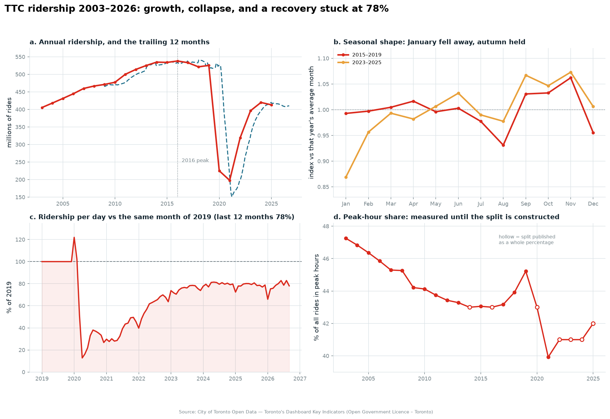
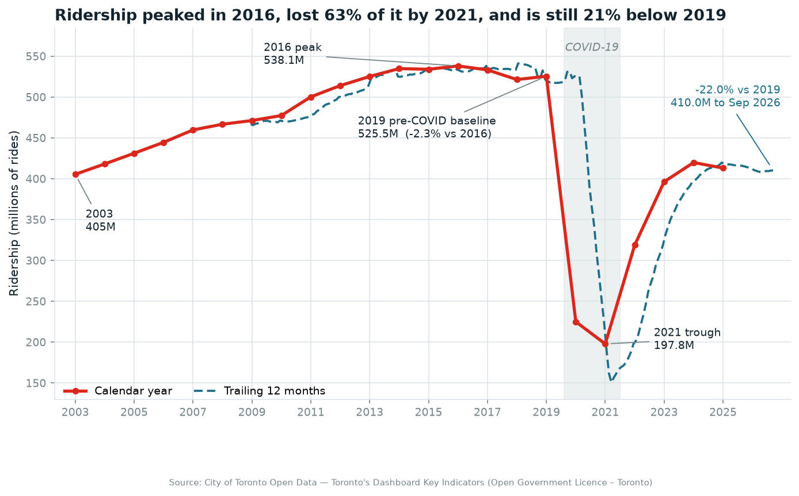
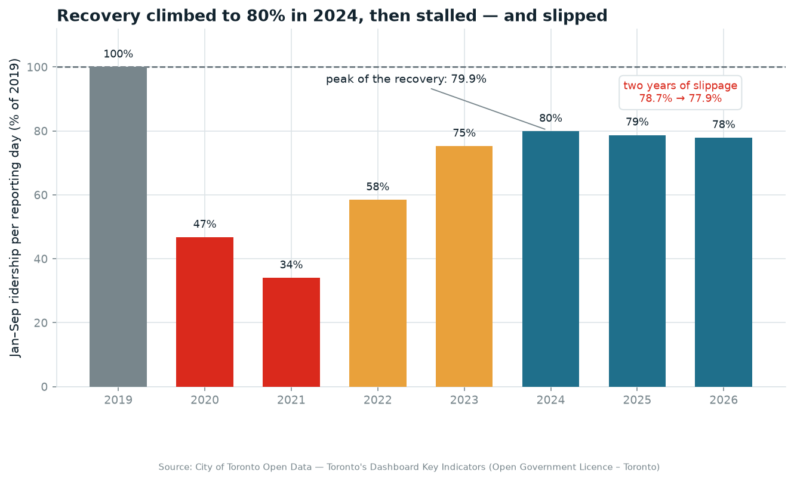
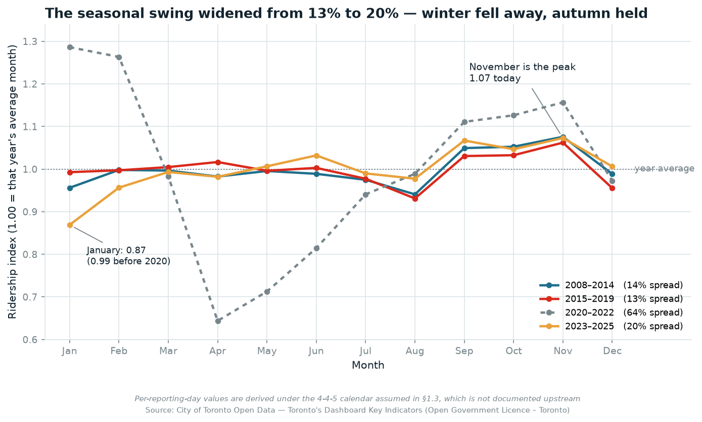
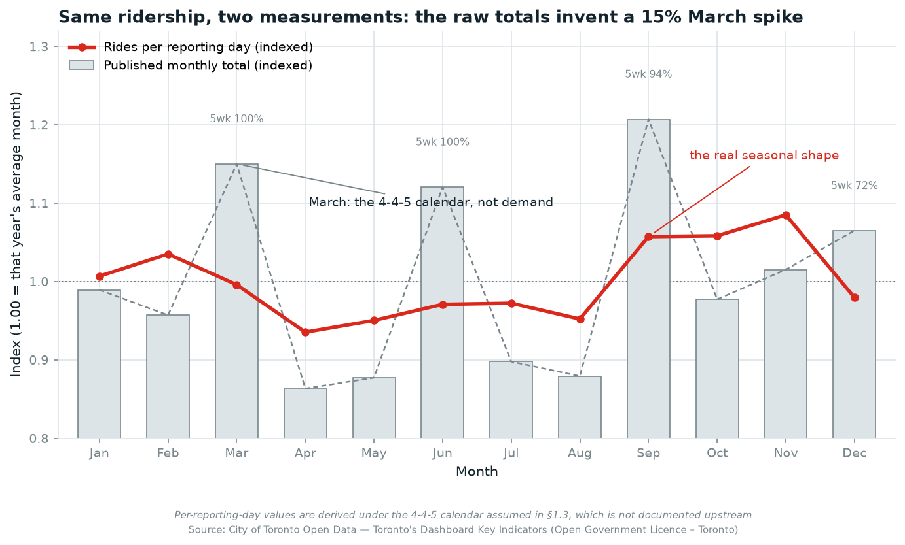
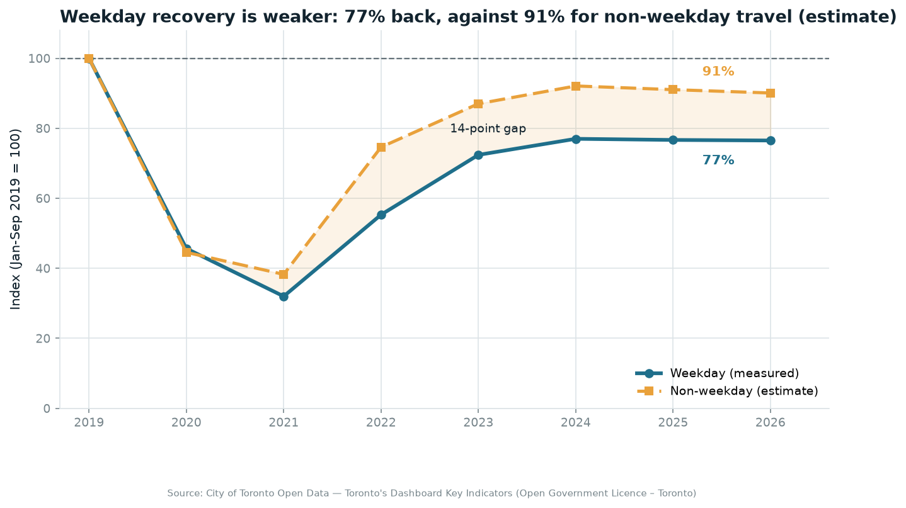
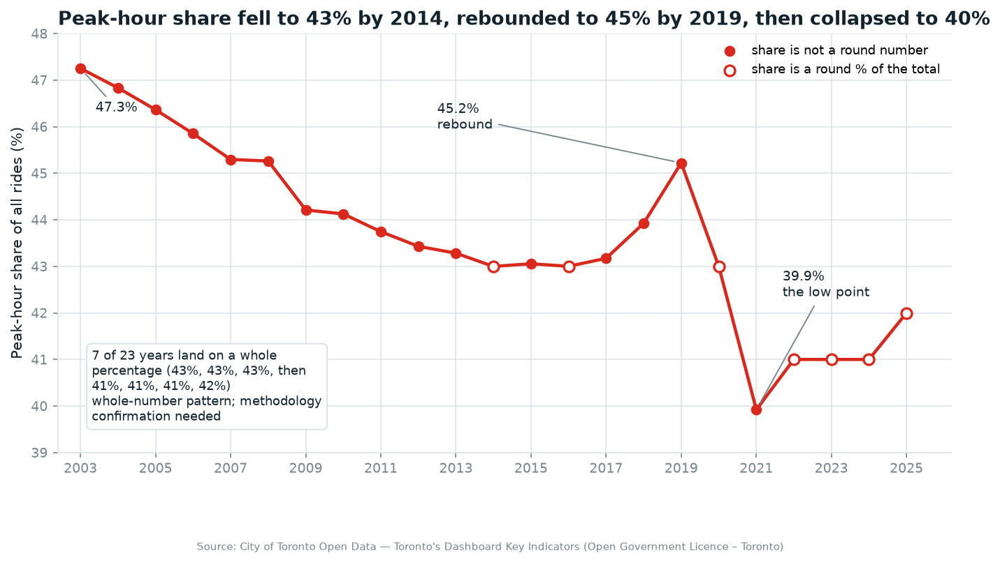

# 🚇 TTC Ridership Analysis

An exploratory data analysis of **Toronto Transit Commission ridership from 2003 to 2026**, built on open data published by the City of Toronto. The project traces two decades of growth to a **2016 peak**, the COVID-19 collapse, and the recovery that has stalled at **78% of 2019** (per reporting day, derived under an assumed 4-4-5 calendar), measured across four indicators: monthly ridership, average weekday ridership, and annual peak / non-peak passenger rides.

This is a portfolio project: every number and chart in the notebook is reproducible from the public data source documented below.

> 📍 Data source: [City of Toronto Open Data Portal — Toronto's Dashboard Key Indicators](https://open.toronto.ca/dataset/toronto-s-dashboard-key-indicators/)

---

## 📁 Project Structure

```
TTC/
│
├── Data_source/
│   └── TorontoMeasureData.csv          # committed — 508 rows × 4 columns (23 KB)
│
├── visualizations/                     # charts exported by the notebook (150 dpi)
│   ├── 02_annual_ridership.png         #   annual totals + trailing 12-month series
│   ├── 02_peak_vs_nonpeak.png          #   peak vs non-peak stacked area
│   ├── 02_yoy_growth.png               #   year-over-year change by era
│   ├── 03_seasonality_heatmap.png      #   rides per day, year × month
│   ├── 03_seasonality_era.png          #   seasonality index by era
│   ├── 03_445_artifact.png             #   raw totals vs rides per reporting day
│   ├── 04_recovery_index.png           #   monthly index vs the same month of 2019
│   ├── 04_recovery_by_month.png        #   recovery completeness by calendar month
│   ├── 04_recovery_ladder.png          #   Jan–Sep recovery ladder, per reporting day
│   ├── 05_peak_share.png               #   peak-hour share, round-number years marked
│   ├── 05_peak_vs_nonpeak_index.png    #   peak vs non-peak indexed to 2019
│   ├── 06_weekday_vs_weekend.png       #   weekday and implied weekend ridership
│   ├── 06_weekend_recovery.png         #   weekday vs weekend recovery index
│   └── 07_dashboard.png                #   2×2 summary dashboard
│
├── ttc_analysis.ipynb                  # EDA notebook
├── requirements.txt                    # pinned dependencies
├── .venv/                              # local virtual environment (not committed)
│
└── README.md
```

---

## 📊 Dataset Overview

| Property | Detail |
|---|---|
| Total Rows | 508 observations |
| Columns | 4 (`Measure Name`, `Year`, `Period`, `Value`) |
| Years | 2003 – 2026 (monthly series start in 2007 / 2008) |
| Measures | 4 |
| Format | Tidy / long — one observation per row |
| Missing Values | 46 nulls in `Period`, all structural (annual measures) |
| Duplicates | None |
| File Size | 23,132 bytes (~23 KB) |
| Committed | Yes — included in the repo, so clone → Run All needs no setup |
| Source Format | Filtered export of a 1.8 MB multi-indicator CSV |

### Columns

| Column | Type | Description |
|---|---|---|
| `Measure Name` | str | One of four TTC indicators (see below) |
| `Year` | int64 | Calendar year of the observation |
| `Period` | str | Month abbreviation (`Jan`–`Dec`); **null** for annual measures |
| `Value` | int64 | Ridership count — monthly figures are raw rides, annual figures are in thousands |

### Measures

| Measure Name | Rows | Granularity | Coverage |
|---|---|---|---|
| `TTC Average Weekday Ridership` | 237 | Monthly | 2007 – 2026 (2026 partial) |
| `TTC Monthly Ridership` | 225 | Monthly | 2008 – 2026 (2026 partial) |
| `TTC Annual Passenger Rides Peak (000s)` | 23 | Annual | 2003 – 2025 |
| `TTC Annual Passenger Rides Non-Peak (000s)` | 23 | Annual | 2003 – 2025 |

> ⚠️ **2026 is incomplete** — it contains January through September only. Any year-over-year comparison against 2026 must be YTD-matched (same months), otherwise the partial year reads as a false ~25% collapse.

---

## 🧪 Data Quality Checks (already verified)

- **No duplicate keys** — `Measure Name` + `Year` + `Period` is unique across all 508 rows.
- **No missing values** in `Measure Name`, `Year` or `Value`.
- **The 46 null `Period` values are structural**, not dirty data — the two annual measures have no month dimension.
- **Series reconcile internally** — summed monthly ridership reproduces the annual peak + non-peak total to within **0.011%** for every year from 2008 to 2025. Once the annual figures are rescaled from thousands to whole rides, the two independently published series agree to rounding.
- **The monthly series behaves as though it is reported on 4-4-5 financial periods, not calendar months** — eight 4-week blocks plus four 5-week blocks, so every year would cover exactly `8 × 28 + 4 × 35 = 364` days. That would explain why monthly ÷ weekday ridership sits at ~26.5 every year: the weighted mix of two regimes, ~24.3 (4-week) and ~30.1 (5-week). **This is an inference, not a documented fact** — see [Reporting periods](#-reporting-periods-are-inferred-not-documented).
- **The peak / non-peak split may be rounded or estimated in some years.** In 7 of 23 years the published peak figure is a *round percentage* of the annual total — 2022, 2023 and 2024 are **41.0001%**, **41.0001%** and **41.0000%**, and 2025 is **42.0000%**, accurate to within a few hundred rides out of ~170M. **The pattern may reflect rounding or estimation; the methodology needs confirmation before small changes in the split are interpreted.** TTC's methodology notes are not published in this extract, so that confirmation is not possible here. Section 5.1 flags those years and treats the split as evidence only up to 2021.
- **The assumed calendar is at least internally coherent.** Using period length and the weekday series to back out non-weekday ridership gives 817,438 rides/day from 4-week periods and 819,200 from 5-week periods — **0.22% apart**. That is evidence the arithmetic and the assumed table hang together; it is *not* evidence that these were TTC's actual reporting periods.

### Data quirk to know about

In the upstream file, annual rows store the *year* in `period_number_in_year` rather than a period index. That is why `Period` is null for annual measures here — the export maps month numbers only for `interval_type == "m"`.

### 📐 Reporting periods are inferred, not documented

**Status: unverified assumption.** The dataset's published metadata — notes, limitations,
collection method and resource descriptions, as returned by the CKAN package record — says nothing
about reporting periods or how a "month" is defined (checked 2026-11-05). So the 4-4-5 calendar
below is inferred from the data, not read off documentation.

The inference comes from two columns in the extract: `monthly rides ÷ average weekday rides` gives
**weekday-equivalent days** per reporting month.

| | 4-week period | 5-week period |
|---|---|---|
| Weekday-equivalent days (median) | 24.34 | 30.26 |
| Observations (2008–2025, excl. 2020–22) | 126 | 63 |
| Range | 20.4 – 27.4 | 27.6 – 38.4 |

The two groups separate by 5.9 days with no overlap, and the table reproduces 364 days in every
complete year. **Mar and Jun are 5-week in every year on record**; the other two 5-week slots rotate
between Jan, Sep, Nov and Dec — 2018 is the only year where the fourth 5-week period falls in
**November**, which is why that year shows a −22.6% December against a +21.2% November.

That is strong circumstantial evidence, and it is why the notebook uses it. It is not proof: a
different reporting mechanism could produce a similar pattern. Anything derived from it — rides per
reporting day, the seasonality index, the non-weekday estimates in Section 6 — should be read as
"adjusted under an assumed 4-4-5 calendar" until it is confirmed against TTC documentation.

Practical consequences, all handled in the notebook:

| If you… | Why it breaks | What the notebook does instead |
|---|---|---|
| compare consecutive months | a 5-week month reads as a **+25%** jump | reports `rides_per_day`, not monthly totals |
| divide by calendar days | 5-week months look 25% more productive | divides by `period_days` (28 / 35) |
| quote a monthly figure as a month | it is a 4- or 5-week period total | labels it a reporting period throughout |

Section 3.3 measures the size of that effect: indexed across months, the raw totals vary **2.36×** more than the same ridership measured per reporting day.

---

## 🚀 How to Run

```bash
# 1. nothing to install and nothing to download — open the notebook and Run All
jupyter notebook ttc_analysis.ipynb
```

Any Python 3 with pandas and matplotlib will run it (verified on pandas 2.2.2 *and* 3.1.0). To reproduce the exact pinned versions instead:

```bash
python3.12 -m venv .venv
source .venv/bin/activate          # Windows: .venv\Scripts\activate
pip install -r requirements.txt
jupyter notebook ttc_analysis.ipynb
```

In VS Code, select `.venv/bin/python` as the kernel for `ttc_analysis.ipynb`. `ipykernel` is in `requirements.txt` so the virtual environment can act as a kernel; if you have no Jupyter installation at all, add `jupyterlab`.

---

## 🔍 Key Findings

Each finding is asserted in the notebook, and the chart that shows it is linked by section.

| Finding | Value |
|---|---|
| **Calendar-year peak** | **2016** — 538.1M rides. Not 2019: ridership fell in three of the four years to 2018 and 2019 was still **−2.3%** below 2016 |
| **Strongest 12 months on record** | **541.3M**, the window ending **February 2018** — higher than any calendar year, because it blends a strong 2017 second half with a strong 2018 first half |
| Growth rate, 2003 → 2016 | **+2.20%/yr** compound, **+32.7%** in total |
| Pre-COVID plateau | 2015–2019: ridership fell in 3 of 5 years, netting out 2.3% below the 2016 peak before the pandemic |
| 2019 → 2020 collapse | **−57.2%** (525.5M → 225.0M rides) |
| Trough year | **2021** — 197.8M rides, **−63.2%** from the 2016 peak |
| 2025 vs 2019 recovery | **−21.4%** — still short of pre-pandemic ridership |
| Peak-hour vs non-peak recovery | peak-hour rides **−27.0%** vs 2019, non-peak **−16.8%**. The direction matches every year from 2015 to 2021, but the 2025 numbers are not independent — the split is arithmetically tied to the annual total |
| **Peak-hour share (measured years)** | **47.25% (2003) → 43.00% (2014) → 45.22% (2019) → 39.92% (2021)**: down 4.3 points over eleven years, back up 2.2 by 2019 (off-peak slipped faster than peak in the plateau), then down 5.3 in the collapse |
| **Peak/non-peak split quality** | the published split lands on a whole percentage of the total in **7 of 23 years** (2014, 2016, 2020, **2022, 2023, 2024, 2025**) — the pattern may reflect rounding or estimation, so methodology needs confirmation before small changes are interpreted (§5.1) |
| **Weekday travel recovered less than non-weekday travel** | 2025 vs Jan–Sep 2019: weekday **76.7%** (measured), non-weekday **91.0%** (**estimated**) — a 14.4-point gap, with the ratio rising from 0.48 to 0.57 |
| 4-4-5 consistency check | backing out non-weekday ridership from 4-week periods gives 817,438 rides/day, from 5-week periods 819,200 — **0.22% apart**, so the arithmetic and the assumed calendar hang together (not proof the calendar was TTC's) |
| 2026 YTD (Jan–Sep) vs 2025 | **−1.0%** (303.4M vs 306.5M) — recovery has plateaued |
| Trailing 12 months to Sep 2026 | **410.0M**, −22.0% vs 2019 |
| **Strongest month** | **November** (index 1.07 vs the year's average month) — not September, which is second at 1.05 |
| **Weakest month** | **January** now, at index **0.87** — it was 0.99 before 2020. Pre-pandemic the trough was August (0.93) |
| Seasonal spread | widened from **13%** (2015–19) to **20%** (2023–25): the swing has deepened, not flattened |
| 4-4-5 distortion | raw monthly totals vary **2.36×** more across months than the true seasonal shape; March reads as +15.5% when its real index is 0.996 |
| **Fastest collapse** | April 2020 fell to **12.8%** of April 2019; March 2020 was 51.5%, and January 2020 was still 122% *(per reporting day — April is 28 days in both years under the assumed calendar, so the ratio equals the raw ratio; if the period lengths differ, it does not)* |
| **Recovery plateau** | Jan–Sep recovery peaked at **79.9%** of 2019 in **2024**, then slipped to **78.7%** (2025) and **77.9%** (2026) — drifting down, not levelling. *(derived under the assumed calendar)* |
| **The shortfall is spread across all months** | On a like-for-like per-day basis each month accounts for **7.1–9.7%** of the 2025-vs-2019 gap (104.6M rides), close to its share of 2019 ridership. January is the largest (9.7% vs 8.7% of 2019 ridership) and has the weakest recovery percentage (72%, falling 77.7% → 72.4% → 65.9%). The raw-ride version misleads: January reads as 17.1% and December as 0.5% only because their period lengths changed between the two years |
| Trap avoided | indexing *raw* monthly totals to 2019 makes December 2025 look like a **98.5%** recovery; per reporting day it is **78.8%**, because Dec 2019 was a 4-week period and Dec 2025 a 5-week one |

### The charts

<p align="center">
  
</p>

<table>
  <tr>
    <td width="50%"><br>
      <sub><b>§2</b> — growth to a 2016 peak of 538.1M rides, a 63% collapse by 2021, and a recovery stuck below 80%</sub></td>
    <td width="50%"><br>
      <sub><b>§4</b> — Jan–Sep recovery peaked at 79.9% of 2019 in 2024 and has slipped two years running</sub></td>
  </tr>
  <tr>
    <td width="50%"><br>
      <sub><b>§3</b> — the seasonal swing widened from 13% to 20% as January fell away and autumn held</sub></td>
    <td width="50%"><br>
      <sub><b>§3.3</b> — the same ridership measured two ways: raw monthly totals invent a 15% March spike</sub></td>
  </tr>
  <tr>
    <td width="50%"><br>
      <sub><b>§6</b> — weekday travel is back to 77% of 2019 (measured); non-weekday travel to 91% (<i>estimated</i>)</sub></td>
    <td width="50%"><br>
      <sub><b>§5</b> — peak-hour share fell to 43% by 2014 and rebounded to 45% by 2019; hollow markers are years where the published share lands on a whole percentage, so it adds nothing beyond the total</sub></td>
  </tr>
</table>

---

## ⚠️ Limitations

- **No route, line or station detail** — this extract is system-wide only, so "which line recovered fastest" is not answerable.
- **No fare revenue** — the upstream dataset also publishes `TTC Ridership Revenues` (237 monthly rows); adding it is the natural next extension.
- **Monthly granularity only** — no daily or hourly ridership.
- **A trailing 12-period window is not a fixed number of days** — it ranges from 357 to 371 as the
  5-week slots rotate (159 of 214 windows are exactly 364), so rolling sums are only approximately
  comparable; `monthly['trailing_12m_per_day']` divides that out.
- **No trip-purpose field** — a weekday trip may be education, shopping, an appointment or leisure as easily as a commute, so "commuting has not returned" is a plausible reading of the weekday gap, not a finding.
- **The reporting calendar is inferred** — no upstream metadata defines how a "month" is measured, so every per-day figure rests on an unverified 4-4-5 assumption (§1.3).
- **2026 is partial** (Jan–Sep) — always compare year-to-date to year-to-date; the notebook's `ytd()` helper exists for exactly this.
- **TTC reports on 4-4-5 week financial periods**, so a "month" in this data is a 4- or 5-week block, not a calendar month. The period table is recovered and asserted in Section 1.3; raw month-over-month comparisons are not used anywhere, and month-level rates are always divided by reporting days (28 / 35), never calendar days.
- **The peak / non-peak split may be rounded or estimated in 7 of 23 years**, including every year since 2022, so claims about peak-hour demand after 2021 cannot lean on it — they lean on the weekday series in Section 6 instead.
- **Single-month values can be revised upstream** — e.g. December 2024 average weekday ridership (1,061k) is 13.0% below both December 2023 and December 2025 in a year that otherwise grew, while the same month's total stayed at 40.7M. It is flagged rather than "corrected", since the true figure is unknown; it also inflates the implied weekend estimate for that month.

---

## 🛠️ Tools Used

- Python 3.12.4
- pandas 3.1.0
- NumPy 2.5.4
- matplotlib 3.11.2
- Jupyter / VS Code notebooks

---

## 📂 Dataset

- **Source:** [City of Toronto Open Data Portal — Toronto's Dashboard Key Indicators](https://open.toronto.ca/dataset/toronto-s-dashboard-key-indicators/)
- **Licence:** [Open Government Licence – Toronto](https://open.toronto.ca/open-data-license/)
- **Records:** 508 observations across 4 TTC indicators, 2003 – 2026
- **Type:** Real open government data, refreshed daily

### Verify the data

The 23 KB extract ships with the repository, so a fresh clone runs the notebook with no download
step. Confirm it has not drifted:

```bash
shasum -a 256 Data_source/TorontoMeasureData.csv
# -> a962c429d162586397261281a74c4503b9bebab7d05cd871075c27e232e886e5
```

| Check | Expected |
|---|---|
| SHA-256 | `a962c429d162586397261281a74c4503b9bebab7d05cd871075c27e232e886e5` |
| Size | 23,132 bytes |
| Rows (excluding header) | 508 |
| Line endings | CRLF (the published export is Windows-formatted) |

If the City refreshes the dashboard and revises a measure's history, this file and its hash change
together — so silent drift is impossible to miss, and the git diff shows exactly which
observations moved.

---

## 👤 Author

**NIO** — data analysis portfolio project. Ridership data © City of Toronto, used under the Open Government Licence – Toronto.
